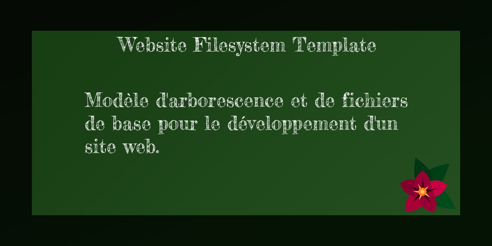

# Website Template

**Website Template** est un modèle d'arborescence et de fichiers de base pour le développement d'un site web. Il fournit une structure prête à l'emploi (dossiers public et privé, routeur, pages d'erreur, traductions) pour démarrer un nouveau projet rapidement.



---

## Sommaire

- [Fonctionnalités](#fonctionnalités)
- [Technologies](#technologies)
- [Installation et configuration](#installation-et-configuration)
    - [Prérequis](#prérequis)
    - [Optionnel](#optionnel)
    - [Compatibilité](#compatibilité)
    - [Installation](#installation)
    - [Administration](#administration)
- [Arborescence](#arborescence)
- [Auteur](#auteur)
- [Crédits](#crédits)
    - [APIs et dépendances](#apis-et-dépendances)
    - [Ressources](#ressources)
- [Licence](#licence)

---

## Fonctionnalités

### Structure
- Séparation des dossiers public et privé.
- Modèle de routeur.
- Fichiers `.htaccess` et `robots.txt`.

### Licence
- Licence MIT : libre d'utilisation, crédits requis.

---

## Technologies

| Technologie            | Utilisation                              |
|------------------------|------------------------------------------|
| HTML5                  | Structure des pages (dans les pages PHP) |
| CSS3                   | Mise en forme                            |
| JavaScript             | Interactions côté navigateur             |
| PHP                    | Pages dynamiques et routage              |
| XAMPP (Apache + MySQL) | Serveur web et base de données           |

---

## Installation et configuration

### Prérequis

Les outils suivants sont nécessaires pour installer et exécuter le projet.

| Outil              | Utilisation                                                    | Téléchargement                                                   |
|--------------------|----------------------------------------------------------------|------------------------------------------------------------------|
| Navigateur moderne | Affichage du site (Chrome, Brave, Firefox…, JavaScript activé) | -                                                                |
| XAMPP              | Serveur web (Apache), PHP et base de données (MySQL)           | [apachefriends.org](https://www.apachefriends.org/download.html) |

### Optionnel

| Outil      | Utilisation                        | Téléchargement                             |
|------------|------------------------------------|--------------------------------------------|
| DBeaver CE | Consultation de la base de données | [dbeaver.io](https://dbeaver.io/download/) |

### Compatibilité

Environnement actuellement testé :

| Composant              | Version / détails                                          |
|------------------------|------------------------------------------------------------|
| Système d'exploitation | Windows 11 26H2                                            |
| Navigateur             | Brave 1.98.62                                              |
| XAMPP                  | 8.5.12 (Apache 2.4.65, PHP 8.5.12, MySQL/MariaDB 10.11.16) |

D'autres environnements peuvent fonctionner, mais n'ont pas nécessairement été testés.

### Installation

1. **Cloner le dépôt GitHub** dans le dossier `htdocs` de XAMPP, afin que le projet soit stocké dans `htdocs/template_website/` :

   ```bash
   cd chemin/vers/xampp/htdocs # C:/xampp/htdocs par défaut
   git clone https://github.com/Hellebore-jpg/template_website.git template_website
   ```

2. **Configurer Apache** pour servir le dossier `public/` du projet, sans toucher au reste de XAMPP :

   1. Ouvrir `chemin/vers/xampp/apache/conf/extra/httpd-vhosts.conf` (`C:/xampp/apache/conf/extra/httpd-vhosts.conf` par défaut).
   2. Ajouter ce bloc à la fin du fichier (adapter le chemin si XAMPP n'est pas installé dans `C:/xampp`) :

      ```apache
      Listen 8080
      <VirtualHost *:8080>
          DocumentRoot "C:/xampp/htdocs/template_website/public"
          <Directory "C:/xampp/htdocs/template_website/public">
              Options Indexes FollowSymLinks
              AllowOverride All
              Require all granted
          </Directory>
      </VirtualHost>
      ```

   3. Vérifier que la ligne `Include conf/extra/httpd-vhosts.conf` n'est pas commentée (pas de `#` devant) dans `apache/conf/httpd.conf`.

3. **Démarrer Apache et MySQL** depuis le panneau de contrôle XAMPP.

4. **Renommer** le fichier `private/ex.config.local.php` en `private/config.local.php`.

5. **Installer la base de données** via [phpMyAdmin](http://localhost/phpmyadmin/) :

   - **Modifier** le fichier `private/database.sql` selon les besoins du projet.
   - Aller dans l'onglet **Importer** et choisir `private/database.sql` (il crée la base de données et ses tables).

6. **Ouvrir l'URL** suivante dans le navigateur : <http://localhost:8080/>

### Administration

Le panneau d'administration est disponible à l'adresse `/chemin/vers/admin`, uniquement pour l'administrateur.

#### Compte de démonstration

| Nom d'utilisateur | Mot de passe | Rôle           |
|-------------------|--------------|----------------|
| `admin`           | `123456789`  | Administrateur |

> **Avertissement :** ces identifiants sont exclusivement destinés aux tests. Changez-les dès que possible et ne les utilisez jamais dans un environnement réel.

---

## Arborescence

```text
template_website/
├── private/                    # Code PHP, identifiants et ressources téléversées
│   ├── lang/                   # Fichiers de traduction
│   ├── src/                    # Pages et code
│   │   ├── pages/              # Pages web
│   │   ├── php/                # Scripts PHP
│   │   └── templates/          # Modèles de pages
│   │
│   ├── uploads/                # Ressources téléversées
│   ├── config.local.php        # Identifiants
│   └── database.sql            # Script de création de la base de données
│
├── public/                     # Racine web et ressources publiques
│   ├── assets/                 # Stockage des ressources
│   │   ├── css/                # Feuilles de style
│   │   ├── font/               # Polices de caractères
│   │   ├── img/                # Images
│   │   │   └── placeholders/   # Images par défaut
│   │   └── js/                 # Scripts JavaScript
│   │
│   └── index.php               # Routeur
│
├── CHANGELOG.md                # Historique des changements du projet
├── LICENSE                     # Texte de la licence
├── README.md                   # Documentation du projet
└── TODO.md                     # Backlog et suivi du projet
```

---

## Auteur

<!-- Développement seul -->
Projet réalisé par [Hellebore-jpg](https://github.com/Hellebore-jpg) dans le cadre du projet **Modèle d'arborescence et de fichiers de base pour le développement d'un site web**, en 2026.

<!-- Développement en équipe
Projet réalisé par {Nombre} collaborateurs dans le cadre du projet **{Nom du projet}** à **{Lieu}**, en {Année}.

| Collaborateur  | Rôle           | GitHub                                           |
|----------------|----------------|--------------------------------------------------|
| {Prénom}       | Chef de projet | [@Vous](https://github.com/Vous)                 |
| {Prénom}       | {Rôle}         | [@Collaborateur-2](https://github.com/Collaborateur-2) |
| {Prénom}       | {Rôle}         | [@Collaborateur-3](https://github.com/Collaborateur-3) |
| {Prénom}       | {Rôle}         | [@Collaborateur-etc](https://github.com/Collaborateur-etc) |
-->

---

## Crédits

Fabriqué avec [Website Template](https://github.com/Hellebore-jpg/template_website) par [Hellebore-jpg](https://github.com/Hellebore-jpg).

### APIs et dépendances

| Dépendance | Utilisation     | Documentation                  |
|------------|-----------------|--------------------------------|
| {API}      | {Utilisation}   | [{Nom}](#lien-vers-le-site)    |
| {Module}   | {Utilisation}   | [{Nom}](#lien-vers-le-site)    |
| {Script}   | {Utilisation}   | [{Nom}](#lien-vers-le-site)    |

### Ressources

- [{Image-1}](#lien-vers-le-site)
- [{Image-2}](#lien-vers-le-site)
- [{Image-3}](#lien-vers-le-site)

---

## Licence

Ce projet est distribué sous licence **MIT**.

Consultez le fichier [LICENSE](LICENSE) pour accéder au texte intégral de la licence.